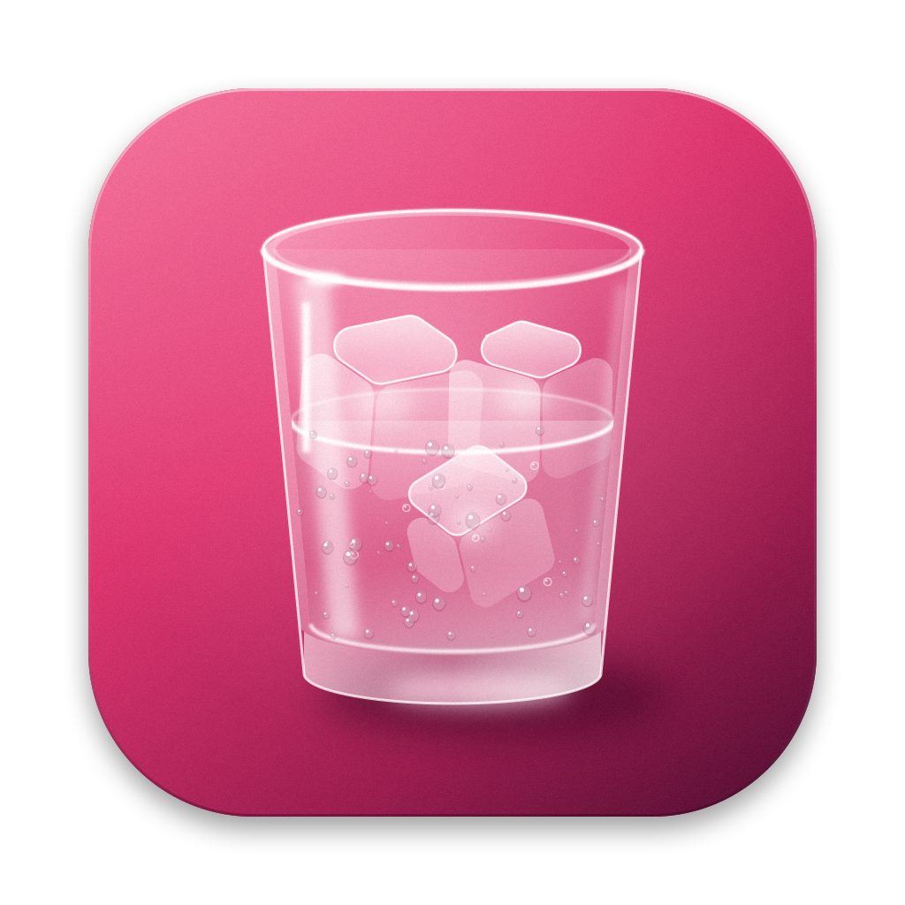
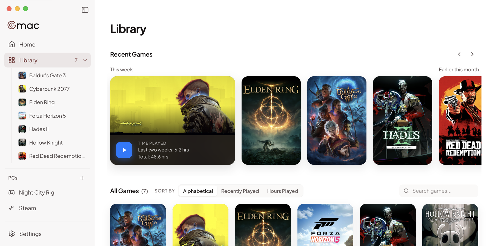

<div align="center">



# Vodka

**Windows games on Apple Silicon Macs.**

A free, native macOS application for running Steam and Windows games.

[Install](#install) · [Features](#features) · [Troubleshooting](#troubleshooting) · [Report a bug](https://github.com/rolling7ho/vodka-stack/issues)

</div>

<p align="center">
  
</p>

Vodka provisions a Windows environment (a Wine prefix) on the Mac, installs Steam into it
and presents the resulting games in a library. No configuration is required to begin; the
per-game settings exist for titles that need them.

Vodka is a fork of [Whisky](https://github.com/whisky-app/whisky), via
[frankea's community fork](https://github.com/frankea/Whisky), focused on Steam gaming.

## Features

**Getting started**
- **Guided Steam setup.** Four steps: create a PC, select graphics settings, install Steam
  and sign in.
- **Library-first interface.** Installed games appear as cards with their artwork. Select
  a card to play.
- **Add to Dock.** Any game can receive its own Dock icon that starts it without opening
  Vodka.

**Graphics and performance**
- **Graphics backend by DirectX version.** Select Automatic, or choose per game:
  DirectX 12 (Apple D3DMetal), DirectX 11 (DXMT), or DirectX 9 and OpenGL/Vulkan
  (WineD3D). Automatic reads each game's imports.
- **DirectX 12.** Vodka guides you to Apple's Game Porting Toolkit download, then locates
  and installs it.
- **Native resolution.** Games render at the display's native pixel count, and Steam
  remains sharp on Retina displays.
- **Faster mode.** Renders a game at a lower resolution and upscales it with MetalFX and
  sharpening.
- **macOS Game Mode.** Engages automatically when a game runs full screen.

**Everyday use**
- **Statistics.** Total and recent playtime, most played titles, longest session and
  storage used.
- **Clean quit.** Quitting Vodka stops Steam and every game it started, after confirmation.
- **Pre-launch warnings.** Games known not to run, or whose anti-cheat blocks Wine, are
  flagged.
- **Simple reset.** Deleting a PC stops the processes running in it and moves it to the
  Trash.

<p align="center">
  
</p>

## Requirements

- A Mac with Apple Silicon (M1 or later)
- macOS Sequoia 15 or later
- Approximately 1 GB of free space for the engine, in addition to space for games

## Install

Vodka is not yet distributed as a signed download, so it is built locally. Xcode 16 or
later is required.

```sh
git clone https://github.com/rolling7ho/vodka-stack.git
cd Vodka
apps/vodka/scripts/install-local.sh
```

The script builds Vodka, signs it for the local Mac only and copies it to `/Applications`.
During first-run setup, Vodka downloads its Wine engine, which is approximately 330 MB
compressed.

### Migrating from Whisky

- **Earlier builds of this fork** (`com.rolling7ho.Whisky`) are carried over automatically
  the first time Vodka opens: PCs, engine, logs, settings and Dock icons.
- **The original Whisky:** select **File › Migrate from the Original Whisky**. Bottles are
  imported in place, so no data is copied.

## Troubleshooting

- [Steam guide](docs/SteamCompatibility.md): Steam windows, sign-in, downloads and game
  launching
- [Launcher troubleshooting](docs/LauncherTroubleshooting.md): Epic, EA App, Battle.net,
  Rockstar and others
- [Crashes and freezes](docs/StabilityTroubleshooting.md): what to collect and how to
  narrow down the cause
- **Help › Run Diagnostics…** in the application produces a report suitable for attaching
  to an issue.

## Uninstall

Moving Vodka.app to the Trash retains your PCs and the engine, so reinstalling resumes
where you left off. To remove everything, back up anything required and run:

```sh
rm -rf /Applications/Vodka.app
rm -rf ~/Library/Containers/com.rolling7ho.Vodka           # PCs and their list
rm -rf ~/Library/Application\ Support/com.rolling7ho.Vodka  # the Wine engine
rm -rf ~/Library/Caches/com.rolling7ho.Vodka ~/Library/Logs/com.rolling7ho.Vodka
rm -f  ~/Library/Preferences/com.rolling7ho.Vodka.plist
```

PCs created in a custom folder remain in that location.

## Privacy

Vodka contains no analytics and collects no usage data. It accesses the network only to
download its engine and Steam's installer, and to check for updates. Game artwork is read
from Steam's local cache.

## Contributing

Bug reports and pull requests are welcome. See [CONTRIBUTING.md](CONTRIBUTING.md) for
building, testing and code style, and [SECURITY.md](SECURITY.md) for private
vulnerability reporting. Every change lands through a pull request; direct pushes to
`main` are not accepted.

## License and credits

Vodka is free software under the [GNU GPL v3](LICENSE). Wine is licensed under the LGPL.
D3DMetal belongs to Apple and is not included; Vodka installs it from Apple's Game
Porting Toolkit.

Vodka builds on the work of:

- [Whisky](https://github.com/whisky-app/whisky) by Isaac Marovitz and contributors
- [frankea/Whisky](https://github.com/frankea/Whisky), the community fork Vodka continues
  from
- [Wine](https://www.winehq.org) and [CrossOver](https://www.codeweavers.com/crossover) by
  CodeWeavers
- [DXVK-macOS](https://github.com/Gcenx/DXVK-macOS) by Gcenx and doitsujin,
  [DXMT](https://github.com/3Shain/dxmt) by 3Shain,
  [MoltenVK](https://github.com/KhronosGroup/MoltenVK) by Khronos and
  [msync](https://github.com/marzent/wine-msync) by marzent
- [Sparkle](https://github.com/sparkle-project/Sparkle),
  [SemanticVersion](https://github.com/SwiftPackageIndex/SemanticVersion) and
  [swift-argument-parser](https://github.com/apple/swift-argument-parser)

For a commercially supported method of running Windows software on a Mac, consider
[CrossOver](https://www.codeweavers.com/crossover). CodeWeavers' work on Wine makes
projects such as this one possible.
