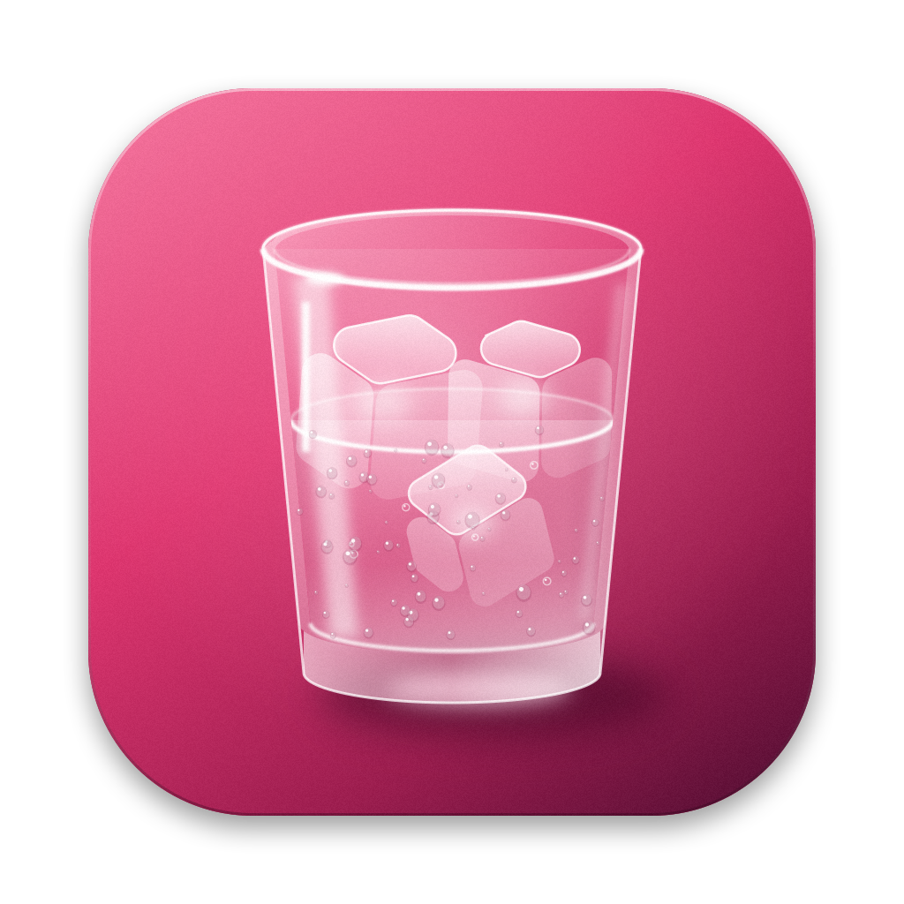
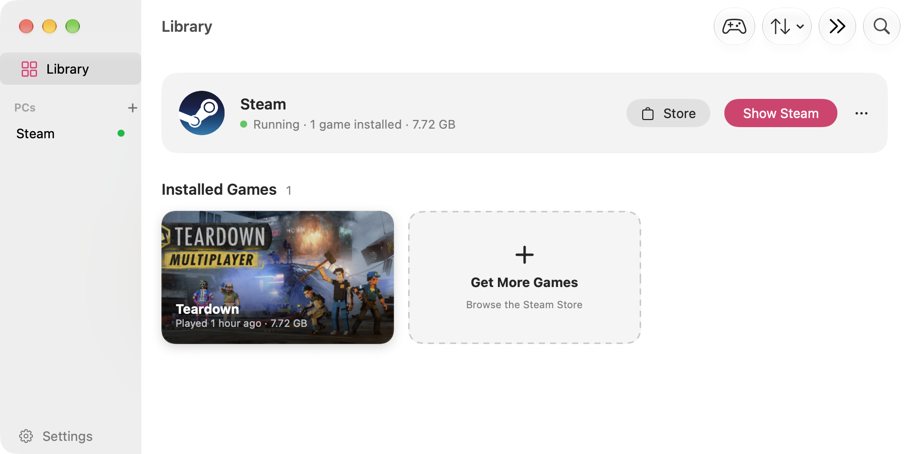
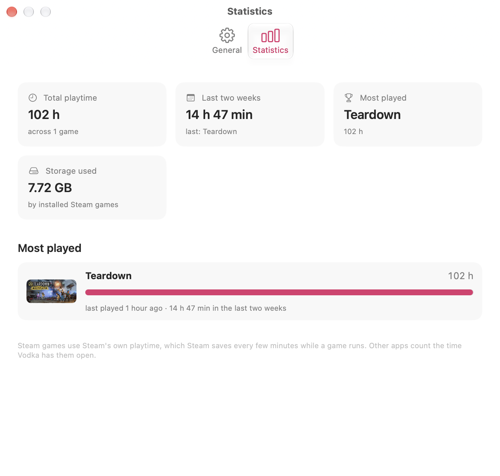

<div align="center">



# Vodka

**Windows games on your Mac, neat.**

A free, native macOS app for running Steam and Windows games on Apple Silicon.

[Install](#install) · [Features](#features) · [Troubleshooting](#troubleshooting) · [Report a bug](https://github.com/rolling7ho/Vodka/issues)

</div>

<p align="center">
  
</p>

Vodka sets up a Windows PC on your Mac (a Wine prefix), installs Steam into it and puts your games
in a library you play from. You don't have to configure anything to get started; the settings are
there for when a game needs them.

It's a fork of [Whisky](https://github.com/whisky-app/whisky), by way of
[frankea's community fork](https://github.com/frankea/Whisky), focused on Steam gaming.

## Features

**Getting started**
- **Guided Steam setup.** Four steps: create a PC, pick graphics, install Steam, sign in.
- **Library first.** Installed games show up as cards with their artwork. Click one to play.
- **Add to Dock.** Any game can get its own Dock icon that starts it without opening Vodka.

**Graphics and performance**
- **Graphics by DirectX version.** Choose Automatic, or set it per game: DirectX 12 (Apple D3DMetal),
  DirectX 11 (DXMT), or DirectX 9 and OpenGL/Vulkan (WineD3D). Automatic reads each game's imports.
- **DirectX 12.** Vodka points you to Apple's Game Porting Toolkit download, then finds and installs it.
- **Native resolution.** Games render at your display's real pixel count, and Steam stays sharp on Retina.
- **Faster mode.** Draws a game at a lower resolution and upscales it with MetalFX and sharpening.
- **macOS Game Mode.** Turns on by itself when a game goes full screen.

**Everyday**
- **Statistics.** Total and recent playtime, most played, longest session and storage used.
- **Clean quit.** Quitting Vodka stops Steam and every game it started, after asking first.
- **Warnings before Play.** Games that are known not to run, or whose anti-cheat blocks Wine, are flagged.
- **Easy reset.** Deleting a PC stops what's running in it and moves it to the Trash.

<p align="center">
  
</p>

## Requirements

- A Mac with Apple Silicon (M1 or later)
- macOS Sequoia 15 or later
- About 1 GB free for the engine, plus room for your games

## Install

Vodka isn't available as a signed download yet, so you build it yourself. You need Xcode 16 or later.

```sh
git clone https://github.com/rolling7ho/Vodka.git
cd Vodka
scripts/install-local.sh
```

The script builds Vodka, signs it for your Mac only and copies it to `/Applications`. The first time
Vodka opens, it downloads its Wine engine (about 330 MB).

### Coming from Whisky

- **Earlier builds of this fork** (`com.rolling7ho.Whisky`) carry over automatically the first time
  Vodka opens: PCs, engine, logs, settings and Dock icons.
- **The original Whisky:** choose **File › Migrate from the Original Whisky**. Your bottles are
  imported from where they already are, so nothing is copied.

## Troubleshooting

- [Steam guide](docs/SteamCompatibility.md): Steam windows, sign-in, downloads and launching games
- [Launcher troubleshooting](docs/LauncherTroubleshooting.md): Epic, EA App, Battle.net, Rockstar and others
- [Crashes and freezes](docs/StabilityTroubleshooting.md): what to collect and how to narrow down the cause
- **Help › Run Diagnostics…** in the app writes a report you can attach to an issue.

## Uninstall

Moving Vodka.app to the Trash keeps your PCs and the engine, so if you reinstall, you pick up where
you left off. To remove everything, first back up anything you want to keep, then run:

```sh
rm -rf /Applications/Vodka.app
rm -rf ~/Library/Containers/com.rolling7ho.Vodka           # PCs and their list
rm -rf ~/Library/Application\ Support/com.rolling7ho.Vodka  # the Wine engine
rm -rf ~/Library/Caches/com.rolling7ho.Vodka ~/Library/Logs/com.rolling7ho.Vodka
rm -f  ~/Library/Preferences/com.rolling7ho.Vodka.plist
```

PCs you created in a custom folder stay wherever you put them.

## Privacy

Vodka has no analytics and collects no usage data. It goes online only to download its engine and
Steam's installer and to check for updates. Game artwork comes from Steam's cache on your Mac.

## Contributing

Bug reports and pull requests are welcome. See [CONTRIBUTING.md](CONTRIBUTING.md) for building,
testing and code style, and [SECURITY.md](SECURITY.md) for how to report a vulnerability privately.

## License and credits

Vodka is free software under the [GNU GPL v3](LICENSE). Wine is licensed under the LGPL. D3DMetal
belongs to Apple and isn't included; Vodka installs it from Apple's own Game Porting Toolkit.

Vodka is built on the work of:

- [Whisky](https://github.com/whisky-app/whisky) by Isaac Marovitz and contributors
- [frankea/Whisky](https://github.com/frankea/Whisky), the community fork Vodka continues from
- [Wine](https://www.winehq.org), and [CrossOver](https://www.codeweavers.com/crossover) by CodeWeavers
- [DXVK-macOS](https://github.com/Gcenx/DXVK-macOS) by Gcenx and doitsujin, [DXMT](https://github.com/3Shain/dxmt) by 3Shain,
  [MoltenVK](https://github.com/KhronosGroup/MoltenVK) by Khronos, [msync](https://github.com/marzent/wine-msync) by marzent
- [Sparkle](https://github.com/sparkle-project/Sparkle), [SemanticVersion](https://github.com/SwiftPackageIndex/SemanticVersion)
  and [swift-argument-parser](https://github.com/apple/swift-argument-parser)

If you'd like a fully supported commercial way to run Windows software on a Mac, consider
[CrossOver](https://www.codeweavers.com/crossover). CodeWeavers' work on Wine is what makes projects
like this one possible.
