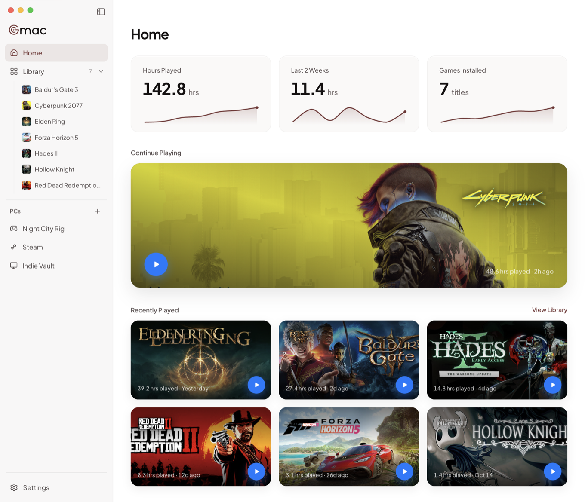

<div align="center">

<p>
  <picture>
    <source media="(prefers-color-scheme: dark)" srcset="./images/brand/gmac-wordmark-dark.svg">
    
  </picture>
</p>

**Play Windows games on Macs.**

A free, native macOS application for running Windows games and PC launchers on Apple Silicon.

[Install](#install) · [Features](#features) · [Troubleshooting](#troubleshooting) · [Report a bug](https://github.com/rolling7ho/gmac/issues)

</div>

<p align="center">
  
</p>

Gmac provisions an isolated Windows environment (a Wine prefix, called a PC in the interface and a bottle in internal paths) on your Mac, installs Steam or other Windows game launchers into it, and presents your games in a unified library. Default settings apply automatically, and per-PC and per-program overrides exist for titles that require tuning.

Gmac is a fork of [Whisky](https://github.com/whisky-app/whisky), via [frankea's community fork](https://github.com/frankea/Whisky).

## Features

**Getting started**
- **Guided Steam setup.** The built-in four-step setup guide creates a dedicated Steam PC, configures graphics defaults (including locating Apple's Game Porting Toolkit download), downloads the official Steam installer from Valve, and opens Steam.
- **Library-first interface.** Installed Steam games and pinned Windows programs appear as cards with artwork. Select a card to start the game.
- **Add to Dock.** Any game or pinned program can receive a standalone Dock shortcut `.app` bundle in `~/Applications` that launches it without opening the main Gmac window.

**Graphics and performance**
- **Graphics backend by DirectX version.** Select **Automatic (Recommended)** or choose a backend per PC or per program: **DirectX 12** (Apple D3DMetal), **DirectX 11** (DXMT), **DirectX 11 (Compatibility)** (DXVK on MoltenVK), **DirectX 9 and older**, or **OpenGL and Vulkan** (WineD3D). Automatic inspects each game's executable imports and selects the matching backend. An optional per-game **Gmac DirectX 12 (DXMT)** (`gmacmetal`) backend is also available when built and staged locally with `scripts/build-gmac-d3d12.sh`.
- **DirectX 12.** Gmac directs you to Apple's Game Porting Toolkit download, verifies Apple's code signature on the disk image, and deploys D3DMetal into the Wine runtime.
- **Native resolution.** Games render at the display's full pixel resolution by default, while Steam and other launchers remain sharp on Retina displays.
- **Faster mode.** Steam games can be toggled individually to **Faster** mode to render at half resolution and upscale with MetalFX.
- **macOS Game Mode.** Wine processes are marked as games so macOS enables Game Mode automatically when a game runs full screen.

**Everyday use**
- **Statistics.** Track total and recent playtime, most played titles, longest session, and storage used under **Gmac › Statistics…** (`⇧⌘S`).
- **Clean quit.** Quitting Gmac stops running launchers and games after confirmation.
- **Pre-launch warnings.** Games known not to run, or whose anti-cheat blocks Wine, are flagged before launch.
- **Simple reset.** Deleting a PC stops any processes running inside it and moves the PC directory to the Trash.

<p align="center">
  
</p>

## Requirements

- Apple Silicon Mac (M1 or later)
- macOS Sequoia 15 or later
- Approximately 1 GB of free disk space for the Wine runtime, in addition to disk space for games

## Install

Gmac is built locally because signed notarized disk images are not yet published on GitHub Releases. Xcode 16 or later is required.

```sh
git clone https://github.com/rolling7ho/gmac.git
cd gmac
scripts/install-local.sh
```

The script builds Gmac in Release configuration, signs it ad hoc for the local Mac, and installs it to `/Applications/Gmac.app`. During first-run setup, Gmac downloads its Wine runtime (`Libraries.tar.gz`), which is approximately 460 MB compressed (458.79 MiB for `v4.6.12-gaming.1`).

### Migrating from Vodka or Whisky

- **Earlier builds of this fork** (`com.rolling7ho.Vodka` and `com.rolling7ho.Whisky`) migrate automatically the first time Gmac opens: PCs, the Wine runtime, logs, settings, and Dock shortcut bundles are moved and updated to `com.rolling7ho.Gmac`.
- **The original Whisky:** select **File › Migrate from the Original Whisky…**. Existing bottles are imported in place without copying game files.

## Troubleshooting

- [Steam compatibility guide](docs/SteamCompatibility.md): Steam setup, graphics routing, downloads, and game launching.
- [Launcher troubleshooting guide](docs/LauncherTroubleshooting.md): Epic Games Store, EA App, Battle.net, Rockstar Games Launcher, Ubisoft Connect, and Paradox Launcher.
- [Stability troubleshooting guide](docs/StabilityTroubleshooting.md): collecting diagnostics and isolating crashes, freezes, and kernel panics.
- **In-app diagnostics:** use **Help › Run Diagnostics…** (`⇧⌘D`) to analyze a program's last run log, **Help › Troubleshoot…** (`⇧⌘T`) for guided checks, or **PC › Settings › Advanced › Diagnostic Reports › Generate Stability Diagnostics** for a bounded triage report.

## Uninstall

Moving `/Applications/Gmac.app` to the Trash retains your PCs and Wine runtime so reinstalling resumes where you left off. To remove all Gmac files, back up any save files you want to keep and run:

```sh
rm -rf /Applications/Gmac.app
rm -rf ~/Library/Containers/com.rolling7ho.Gmac
rm -rf ~/Library/Application\ Support/com.rolling7ho.Gmac
rm -rf ~/Library/Caches/com.rolling7ho.Gmac ~/Library/Logs/com.rolling7ho.Gmac
rm -f  ~/Library/Preferences/com.rolling7ho.Gmac.plist
```

Custom-location PCs outside `~/Library/Containers/com.rolling7ho.Gmac/Bottles` remain at their chosen paths. Any Dock shortcut `.app` bundles created with **Add to Dock** reside in `~/Applications` and can be removed from there if no longer needed.

## Privacy

Gmac contains no analytics and collects no usage data. It accesses the network only to check runtime metadata, download the Wine runtime archive, download the official Steam installer when requested, and check for application updates. Game artwork is read from local caches.

## Contributing

Bug reports and pull requests are welcome. Read [CONTRIBUTING.md](CONTRIBUTING.md) for building, testing, and code style, and [SECURITY.md](SECURITY.md) for private vulnerability reporting. Every change lands through a pull request targeting `main`; direct pushes to `main` are not accepted.

## License and credits

Gmac is free software under the [GNU GPL v3](LICENSE). Wine is licensed under the LGPL. Apple D3DMetal is proprietary to Apple and is not included; Gmac installs it only from a user-supplied Game Porting Toolkit disk image.

Gmac builds on the work of:

- [Whisky](https://github.com/whisky-app/whisky) by Isaac Marovitz and contributors
- [frankea/Whisky](https://github.com/frankea/Whisky), the community fork Gmac continues from
- [Wine](https://www.winehq.org) and [CrossOver](https://www.codeweavers.com/crossover) by CodeWeavers
- [DXVK-macOS](https://github.com/Gcenx/DXVK-macOS) by Gcenx and doitsujin,
  [DXMT](https://github.com/3Shain/dxmt) by 3Shain,
  [MoltenVK](https://github.com/KhronosGroup/MoltenVK) by Khronos, and
  [msync](https://github.com/marzent/wine-msync) by marzent
- [Sparkle](https://github.com/sparkle-project/Sparkle),
  [SemanticVersion](https://github.com/SwiftPackageIndex/SemanticVersion), and
  [swift-argument-parser](https://github.com/apple/swift-argument-parser)

For a commercially supported method of running Windows software on a Mac, consider [CrossOver](https://www.codeweavers.com/crossover). CodeWeavers' work on Wine makes projects such as this one possible.

## Related repositories

- [rolling7ho/winecx](https://github.com/rolling7ho/winecx): patched Wine and CrossOver source tree used to build Gmac's runtimes.
- [rolling7ho/dxmt](https://github.com/rolling7ho/dxmt): Metal-based Direct3D 11/10 implementation and `gmacmetal` Direct3D 12 bridge.
- [rolling7ho/openv](https://github.com/rolling7ho/openv): open-source single-player ScriptHookV replacement for GTA V Enhanced.
